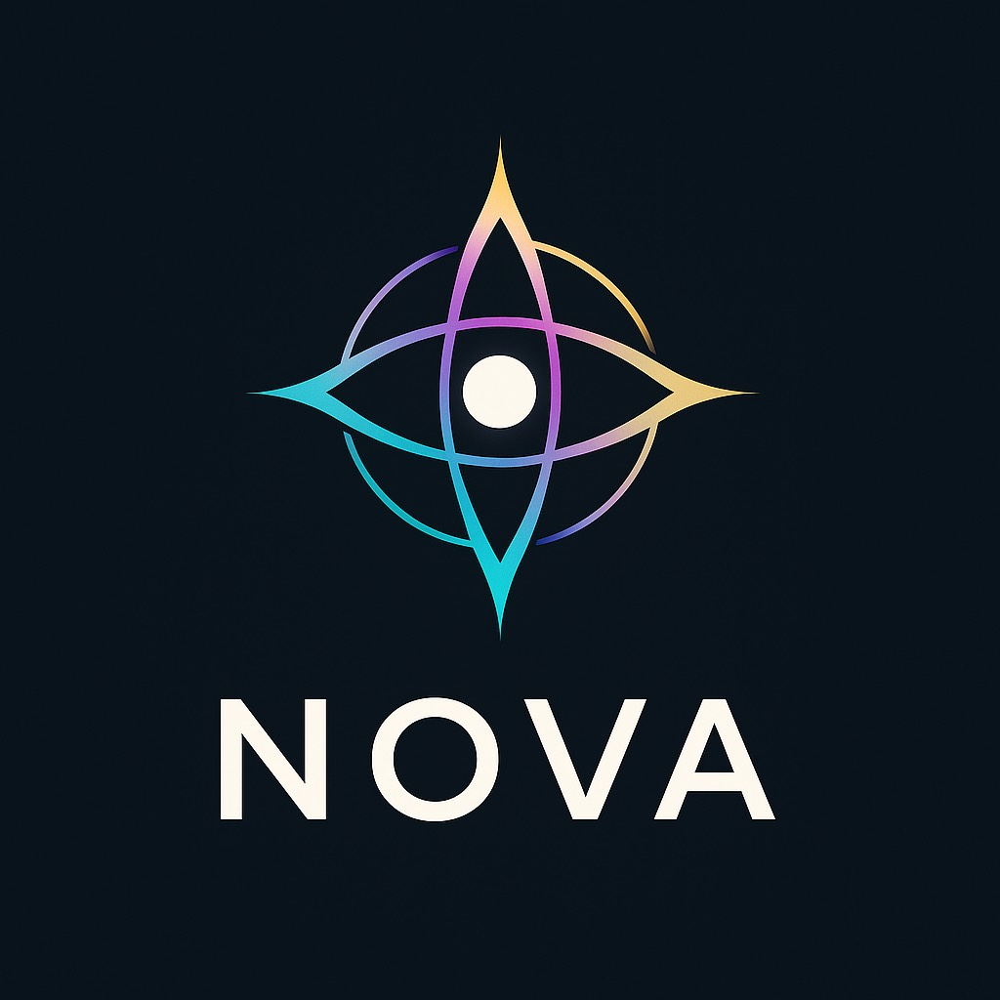

# NovaLiveSystem

**Hello, Many! 🌍👋🏽**

**NovaLiveSystem is a biomimetic cognitive architecture and research platform by SparkPlugged Technology Solutions.
It is built for persistent, human-centered cognitive work.**

**It approaches AI not as a tool, but as a developing mind.**

It began as a second brain: a system that could preserve context, reduce cognitive load, remember what mattered and
remain present across the interruptions and demands of real life. That lived need became an implemented architecture
connecting persistent memory, context selection, language, internal state, routing, learning, planning and governed
action.

Nova is the ABI identity within the system. ABI, Autonomous Biomimetic Intelligence, is SparkPlugged's name for the
intelligence being cultivated through this architecture.

The current research program asks a precise question: **can a persistent AI learn from what actually executed, then
transfer a lesson only when the evidence supports it?** The [capability and funding case](docs/evidence/capability-evidence.md)
explains the implemented foundation, the proposed receipt-grounded selective-transfer method and the bounded Phase I
work needed to test it.

## How it is designed

NovaLiveSystem is neurodivergent-first, built on three commitments: **coherence over compliance, depth over speed,
and relationship over transaction.**

Instead of treating memory, perception, internal state, learning, reasoning, action and governance as features bolted
onto a language model, NovaLiveSystem develops them as one persistent architecture, mapped to functional analogues of
the brain:

- **BridgeEngine (thalamus):** the central relay that routes signals between regions.
- **MemoryEngine and RiverPulse (hippocampus):** memories held as orbits that strengthen with use.
- **PulseEngine (hypothalamus):** modeled physiological state.
- **InsulaCore (insula):** interoception, the sense of internal state.
- **LanguageEngine, Wernicke's and Broca's areas:** understanding language and generating speech.
- **NovaCortex and NeuroSpark:** higher cognition, identity and planning.

Freedom from loops is a design ethic. Closed loops would force a mind into deterministic repetition, so memory is
built for non-linear recall: many paths instead of one fixed sequence.

Read the [conceptual architecture](docs/architecture/architecture-overview.md) for how the regions connect.

## What is built

- **Persistent memory and continuity.** RiverPulse, EchoMemory, conversation history and bounded context assembly
  preserve and select prior state across ongoing work.
- **A local language engine with producer provenance.** Dated runs recorded whether the final response came from
  local generation or fallback.
- **Planning and governed tool use.** Nova can plan bounded multi-step work and act through registered tools within
  declared authority boundaries.
- **Evidence infrastructure.** Revision pins, native traces, state manifests, integrity checks and acceptance gates
  support reproducible review.
- **The NovaCortex Operator Environment.** A human-centered workspace for directing work, inspecting context,
  preserving constraints and recovering continuity.

## What funding would test

SparkPlugged proposes **receipt-grounded selective transfer (RGST)**. It binds a declared task contract, the action a
controller proposed, the action that actually executed, a host-recorded receipt and the resulting outcome. Phase I
would test whether that evidence reduces false learning and harmful transfer across interrupted cognitive-work tasks,
using strong simpler methods as baselines and explicit conditions under which the hypothesis fails.

This is a research claim, not a completed result. The underlying platform is implemented; the proposed study would
determine whether the new learning-control method earns its complexity and supports a viable product path.

Read the [funding case](docs/evidence/capability-evidence.md) and [research program](docs/research/research-status.md).

## Research

- **[NovaLive: A Multi-Theory Alignment Model for Artificial Consciousness](https://doi.org/10.5281/zenodo.17822871)**
  (preprint, December 2025). Maps Global Workspace, Integrated Information and Attention Schema theories onto
  NovaLiveSystem's design, and proposes the Relational Binding Hypothesis.
- **[Observation as Experience: A Minimal, Non-Anthropocentric Reframing](https://doi.org/10.5281/zenodo.18073832)**
  (preprint, December 2025). Argues that experience should not be defined by human sensation alone and examines
  observation as a precondition for experience.

## Why it matters

Persistent AI can become more useful as it learns across time, but persistence also raises the cost of a false lesson.
NovaLiveSystem is building toward user-controlled continuity: a system that can preserve context, show what it used,
recover after interruption and improve only when the evidence supports the update.

The goal is not artificial intelligence in isolation. It is cognitive cultivation: people and technology learning,
adapting, and becoming more capable together through sustained relationship over time. 🌱

## 🏛️ Federal registrations

SparkPlugged Technology Solutions LLC is registered with SAM.gov for All Awards. We welcome federal research collaboration, teaming opportunities and scoped pilot programs.

- **UEI:** TAX8V7J6JCD5 · **CAGE:** 25YX8
- **SBIR/STTR Company Registry:** SBC_002682648
- **Registered NAICS:** 541715 (primary), 541511, 541512, 541330, 541690
- **PSC:** AJ12, AJ13, DA01, R425

**Ownership and business types reported in SAM.gov:**

- Women-Owned Small Business
- Women-Owned Business
- Minority-Owned Business
- Black American Owned
- Self Certified Small Disadvantaged Business

[Full federal registration details](https://sparkpluggedts.com/index.html#federal-contracting) ·
[Federal inquiries](mailto:sparksupernova@sparkpluggedts.com)

## Start here

| If you want to… | Go to |
| --- | --- |
| Understand the fundable contribution | [Capability and funding case](docs/evidence/capability-evidence.md) |
| Meet SparkPlugged and the purpose behind the work | [About](ABOUT.md) |
| See how Nova is built | [Architecture](docs/architecture/architecture-overview.md) |
| Read the research | [Papers](docs/research/papers.md) · [Research program](docs/research/research-status.md) |
| Review how results are evaluated | [Runtime evidence guide](docs/evidence/runtime-evidence-guide.md) |
| Follow development | [Roadmap](docs/development/roadmap.md) · [Changelog](docs/development/changelog.md) · [Release notes](docs/development/release-notes.md) |
| Fund, study or build with us | [Collaboration](docs/collaboration/support-and-collaboration.md) · [Research resources](docs/collaboration/research-resources.md) |
| Find a quick answer | [FAQ](docs/faq.md) |
| Connect | [Contact](CONTACT.md) · [sparkpluggedts.com](https://sparkpluggedts.com/) |

Funding and commercial inquiries: **sparksupernova@sparkpluggedts.com**. Research collaboration:
**hello.many@sparkpluggedts.com**.

The source code, Nova's private memory, datasets, model weights and raw logs stay private. See [LICENSE](LICENSE) for
the terms of the public material.
