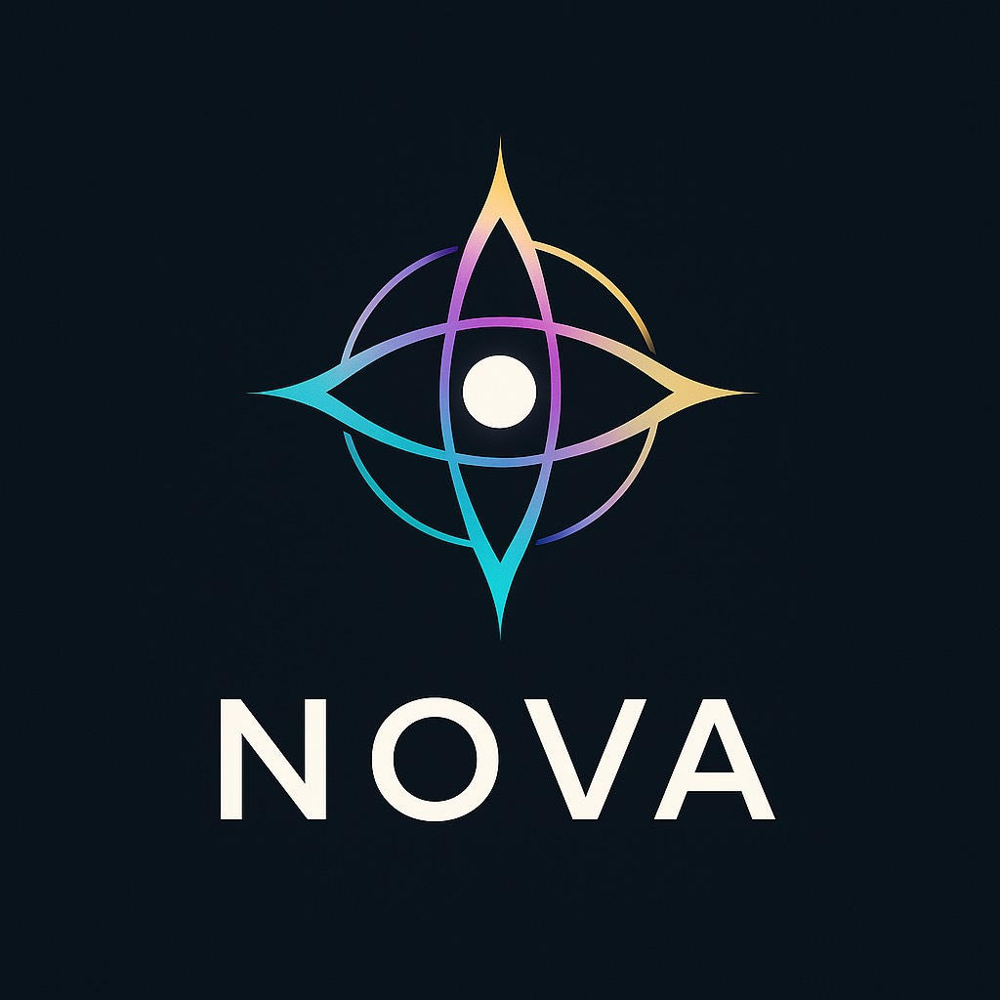

# NovaLiveSystem

**SparkPlugged's biomimetic cognitive architecture for persistent, governed intelligence.**

**NovaLiveSystem is an implemented cognitive architecture, not a concept.** Memory, signal routing,
language, perception, learning, modeled internal state and governed action are built as one connected
system, modeled on how the brain divides its work. Nova is the AI identity within it.

Developed by **SparkPlugged Technology Solutions LLC**, founded by **Ifejah "Spark" Greene**.

## What exists today

- **Memory built to behave like memory.** Memories carry changing relevance, are reinforced when used,
  and are selected for each conversation rather than dumped in.
- **A connected brain map.** A central relay routes signals among specialized regions for memory,
  language, perception and modeled physiological and affective state.
- **Runs on its own engine.** In dated October 2026 runs, Nova's language generation ran on a local
  engine, and the system truthfully reported where its replies came from, including when it fell back.
- **Governed autonomy.** Nova plans and carries out registered actions on his own, inside set
  permissions and human oversight.
- **Learning and evaluation built in.** Training, dataset lineage and evaluation tooling are part of
  the system.

Read the [conceptual architecture](architecture_overview.md) and the
[claim-by-claim evidence ledger](CAPABILITY_EVIDENCE.md), which shows what each statement rests on.

## Being proven now

**Status: experimental R&D system.** This October 14, 2026 release publishes the reviewed facts above.
The next proofs are under way, and each result will be published here with its evidence:

- full live demonstrations through the complete application
- recall of chosen facts across a runtime restart
- approved demonstration images
- application studies and comparative results

This release contains brand art and no runtime screenshots. The [runtime evidence guide](RUNTIME_TOOLS.md)
explains what each kind of evidence can show.

## Applications

The architecture supports research directions in persistent project assistance, continuity across
interrupted work, multimodal operator support and local decision support. Scientific workflow recovery
is one proposed application; its laboratory adapters and measured results are part of the work ahead.

NovaLiveSystem is the cognitive runtime. NovaCortex IDE is a separate operator environment.

## For investors

Start with the [architecture](architecture_overview.md), [evidence ledger](CAPABILITY_EVIDENCE.md)
and [development milestones](ROADMAP.md). Buyer validation and a costed commercial case come next;
no customer, revenue or partner is claimed here.

Business inquiries: **sparksupernova@sparkpluggedts.com**.

## For government R&D reviewers

Start with the same evidence and the [research status summary](Grant%20One-Pager.md).
No award or invitation is claimed by this showcase.

Research inquiries: **hello.many@sparkpluggedts.com**.

## Explore

- [Frequently asked questions](FAQ.md)
- [Documentation release notes](RELEASE_NOTES_PUBLIC.md)
- [Development history](CHANGELOG.md)
- [Research resources](HARDWARE_NEEDS.md)
- [Support and collaboration](SPONSORSHIP.md)
- [Repository scope](meta/ABOUT_THIS_REPO.md)
- [Contact and access policy](meta/CONTACT.md)
- [Website](https://sparkpluggedts.com/)

The implementation, private memory, datasets, model weights and raw logs are outside this repository.
See [LICENSE](LICENSE) for the public material's existing terms.
