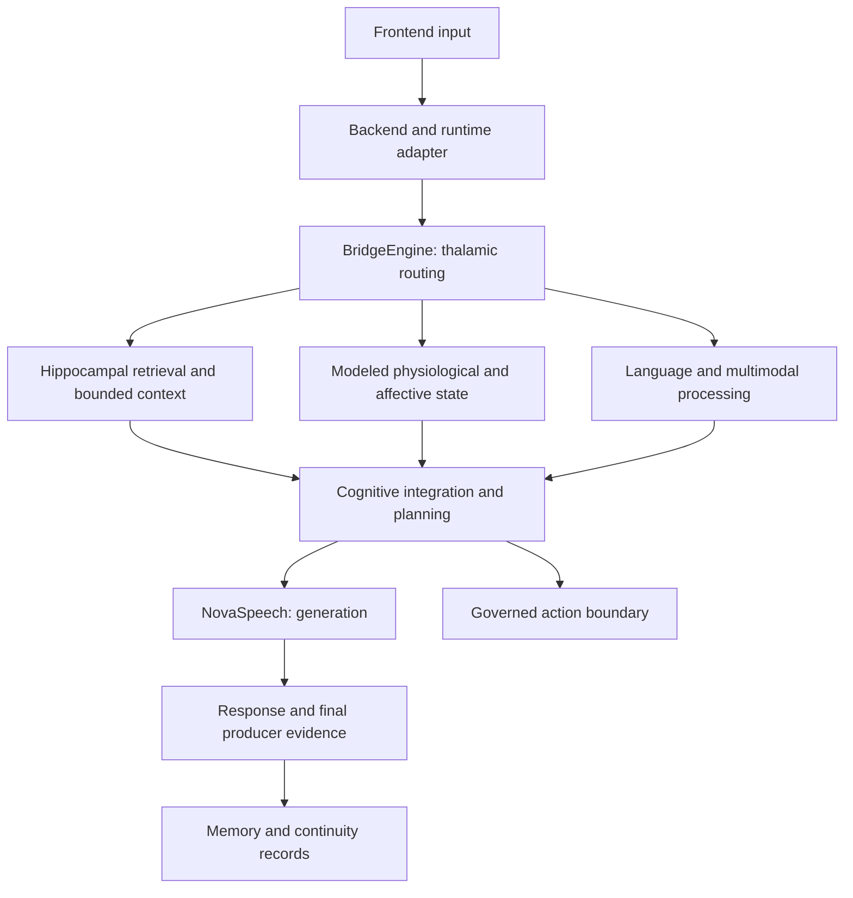

# NovaLiveSystem: conceptual architecture

**Source baseline reviewed October 7; public wording reviewed October 14, 2026.** This is a public conceptual map of an implemented cognitive foundation.
It replaces a December 2025 component inventory; source counts and model directories are not capability
evidence. See [CAPABILITY_EVIDENCE.md](CAPABILITY_EVIDENCE.md) for status and observation limits.

## Connected cognitive regions

NovaLiveSystem uses specialized processors and inter-region signal routing. Memory, modeled internal
state, perception, learning and language contribute to the same runtime rather than a collection of
independent product modules.

| Region or component | Architectural role |
| --- | --- |
| Thalamus / BridgeEngine | Routes inputs and signals; coordinates retrieval, state and cognitive processing |
| Hippocampal memory system | MemoryEngine, RiverPulse, EchoMemory and context assembly preserve and select history |
| Hypothalamus / PulseEngine | Models physiological state used in processing |
| Presence and limbic processing | Affect, salience, relational boundaries and protected interaction context |
| Language network / LanguageEngine | Language processing and search-related integration |
| Broca / NovaSpeech | Response generation |
| Wernicke | Language comprehension |
| Higher cognition / NovaCortex and NeuroSpark | Integration, signal validation, bounded processing and planning |
| Occipital and cross-modal processing | Visual interpretation and integration with other signals |
| Governed tools and action boundary | Registered operations, authority checks and operator oversight |

Biological names are functional analogies implemented in software. They are not claims of biological
equivalence, consciousness, accurate emotional inference or a functioning physical sensor.

## Conceptual response path

This describes intended component relationships supported by source inspection. Each demonstration
must independently establish its actual frontend/backend/routing/generation path with native evidence.
A diagram or static analyzer does not prove every route executes.

## Memory and identity continuity

Orbit lifecycle includes changing relevance, decay and access reinforcement. RiverPulse persistence,
EchoMemory, conversation history and bounded context assembly serve different roles. These are not a
single flat cache.

Authenticated creator and Guest interactions have different context/privacy boundaries. Persistence
and identity-specific routing exist in the implementation; reliability of selected recall across a
real runtime restart still requires the planned synthetic demonstration.

An artifact hash detects changes to retained bytes. It does not authenticate the original observation,
prove the model recalled a fact or guarantee permanent retention.

## State, models and governed action

Internal-state and affective components can influence processing. A generated description of
“pulse,” memory or awareness is not proof that the model read live telemetry.

Earlier training used Qwen2.5-based checkpoints. The cognitive architecture is distinct from any one
model; each dated run must identify the actual model, settings, serving source and final response
producer. Local language serving has dated observation evidence. Voice, vision, other routes and
complete data-flow guarantees require their own verification.

Planning and tool orchestration exist alongside authority boundaries. Tool registration is not
authorization for arbitrary action, instrument control or an independently operating laboratory.

## Runtime and operator environment

**NovaLiveSystem** is the cognitive runtime. **NovaCortex IDE** is the separate operator environment.
Source inspection supports implemented interface components; live connectors, mock state and domain
adapters must be distinguished in every capture.

Detailed internals and private state remain outside this public repository. See
[repository scope](meta/ABOUT_THIS_REPO.md) and [evidence limits](CAPABILITY_EVIDENCE.md).
