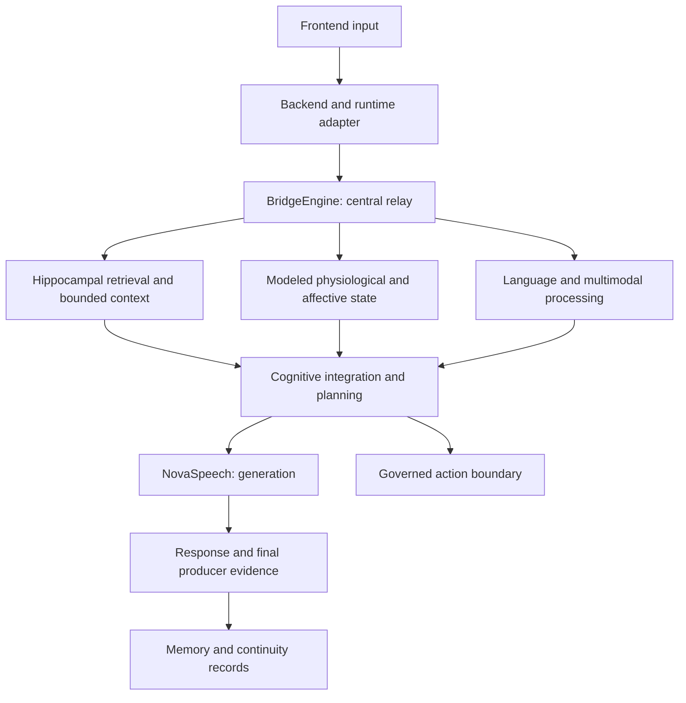

# NovaLiveSystem: conceptual architecture

**Updated November 9, 2026.** This is a public conceptual map of NovaLiveSystem's implemented cognitive foundation.
See the [capability and funding case](../evidence/capability-evidence.md) for how the platform supports the current
research program.

## Connected cognitive regions

NovaLiveSystem uses specialized processors and inter-region signal routing. Memory, modeled internal
state, perception, learning and language contribute to the same runtime rather than a collection of
independent product modules.

| Region or component | Architectural role |
| --- | --- |
| BridgeEngine (central relay; thalamus-inspired) | Routes inputs and signals; coordinates retrieval, state and cognitive processing |
| Hippocampal memory system | MemoryEngine, RiverPulse, EchoMemory and context assembly preserve and select history |
| Hypothalamus / PulseEngine | Models physiological state used in processing |
| Presence and limbic processing | Affect, salience, relational boundaries and protected interaction context |
| Language network / LanguageEngine | Language processing and search-related integration |
| Broca / NovaSpeech | Response generation |
| Wernicke | Language comprehension |
| Higher cognition / NovaCortex and NeuroSpark | Integration, signal validation, bounded processing and planning |
| Occipital and cross-modal processing | Visual interpretation and integration with other signals |
| Governed tools and action boundary | Registered operations, authority checks and operator oversight |

BridgeEngine is the central relay coordinating signals across specialized regions. Its thalamus-inspired placement
reflects that implemented role.

Biological names are functional analogies that describe software roles and relationships within the architecture.

## Conceptual response path

This map reflects source-inspected component relationships. Dated demonstrations pair it with native frontend,
backend, routing and generation traces to show the path taken in a specific run.

## Memory and identity continuity

Orbit lifecycle includes changing relevance, decay and access reinforcement. RiverPulse persistence,
EchoMemory, conversation history and bounded context assembly serve distinct roles that form a layered continuity
system rather than a flat cache.

Authenticated creator and Guest interactions have different context and privacy boundaries. Persistence and
identity-specific routing are implemented, with restart-based recall included in the continuing acceptance program.

Artifact hashes support byte-integrity checks. Recall acceptance combines those checks with runtime observations of
what the system retrieved and used.

## State, models and governed action

Internal-state and affective components can influence processing. Public evidence distinguishes modeled state,
generated self-description and direct runtime telemetry.

Earlier training used Qwen2.5-based checkpoints. The cognitive architecture is distinct from any one model; dated
runs record the actual model, settings, serving source and final response producer. Local language serving has dated
observation evidence, with voice, vision and other routes evaluated through their own acceptance records.

Planning and tool orchestration operate through registered capabilities, authority boundaries and operator oversight.

## Runtime and operator environment

**NovaLiveSystem** is the cognitive runtime. **NovaCortex IDE** is the separate operator environment.
Source inspection supports implemented interface components; live connectors, mock state and domain
adapters must be distinguished in every capture.

Detailed internals and private state are protected outside this public repository. See
[repository scope](../../ABOUT.md) and the [capability and funding case](../evidence/capability-evidence.md).
